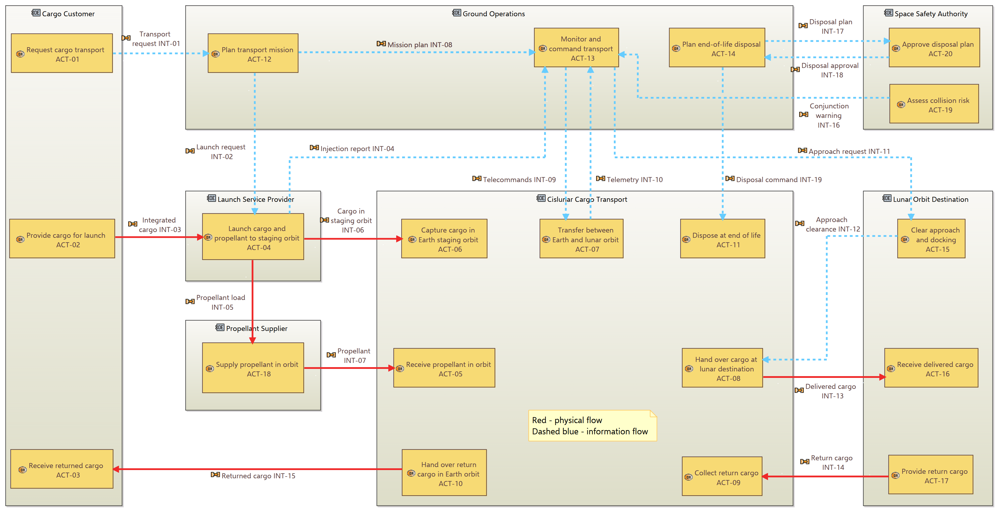
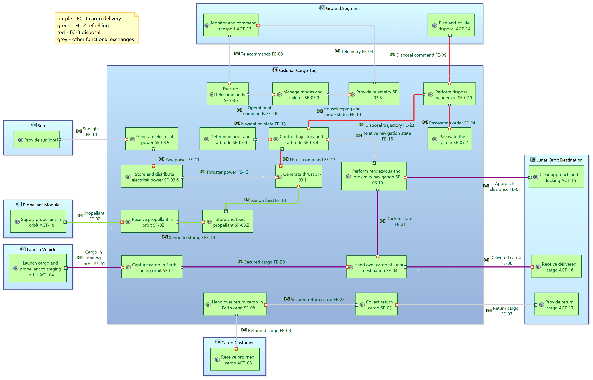

# Cislunar Electric Cargo Tug: a Phase 0/A systems engineering study

A small, public-information-only study of a **reusable, refuellable solar-electric cargo tug** that moves cargo from a high Earth orbit (GTO-class) to a Near-Rectilinear Halo Orbit (NRHO) and back, modelled with **Arcadia / Capella**.

> **Read first:** the [study report (PDF)](report/cislunar-tug-study-report.pdf), a 16-page summary of every phase with the Capella diagrams and registers in appendices.
> This is a personal learning and portfolio project. It is not a flight-ready design, and every number is a stated, traceable assumption rather than a verified result.

## Why this study

ESA Strategy 2040 and Explore2040 both point to a "Hub-and-Spoke" logistics network with electric-propulsion space tugs, in-orbit refuelling and servicing, and European non-dependence. This study takes that premise and asks what a minimal, credible tug concept looks like, and how its requirements, trade-offs, technology maturity and cost drivers would be worked through at Phase 0/A.

The focus is on the systems engineering process:

- mission definition and operational analysis
- requirements flow-down from system to 2-3 subsystems, with traceability
- architecture trade-offs (power level vs transfer time; refuelling concept)
- logical architecture
- TRL assessment of critical technologies and main cost drivers

## Mission in one paragraph

A 5,000 kg cargo is launched by Ariane 6 to GTO, picked up by the tug, carried by low-thrust electric propulsion to NRHO, and the tug returns to be refuelled and repeat. Design point after the trade-offs: 25 kW of electric propulsion power (1.46 N at 2,100 s Isp) from five 5 kW-class European thrusters plus one spare, used in rotation (two 12 kW-class thrusters at 24 kW are the option), a round trip of 1.5 years and 9 trips in a 15-year life. The tug is refuelled by fluid transfer from a xenon module launched together with each cargo. Low lunar orbit is deliberately excluded from the baseline (about 1.6 km/s more delta-v per leg, a lower cargo limit, long eclipses). A direct-launch baseline is kept as the comparison the tug has to beat.

## Repository contents

| File | Description |
|---|---|
| `mission-definition-note.md` | Mission definition note (TUG-MDN-001, Issue 2): objectives, stakeholders, constraints, flight mechanics, ConOps, preliminary system requirements, assumption log (A-01..A-18), decision log (D-01..D-10), references |
| `docs/operational-analysis.md` | Operational analysis: 7 entities, 5 capabilities, 20 activities, 19 interactions, one round-trip scenario |
| `docs/system-analysis.md` | System analysis: boundary, mission and capabilities, 17 leaf functions, 24 exchanges, 3 functional chains, 7 modes, 24 system and 11 subsystem requirements with traceability |
| `docs/trade-offs.md` | Trade 1 power vs transfer time and thruster configuration (quantitative), Trade 2 refuelling concept (weighted scoring with sensitivity), requirement updates |
| `docs/logical-architecture.md` | Logical architecture: 8 logical components, 22 allocated functions, 20 component exchanges, 7 interface requirements, power budget per mode (array, battery, heat), requirement allocation to components |
| `docs/trl-and-cost.md` | TRL and cost assessment: 5 critical technologies with TRL now and the path to TRL 6 by the end of Phase B1, bottom-up mass budget with ESA margins, thruster life strategy, ranked cost drivers and the direct-launch comparison |
| `docs/calculation-model.md` | Calculation model: physics and formulas, code structure and main functions, step-by-step guide to running it |
| `requirements/` | System, subsystem and interface requirements as CSV (current values, updated by every later phase), with sources, allocation to functions and to logical components, and verification method |
| `model/` | Python calculation and trade model: every number in the note reproduced from one parameter file, with a calculation log (formula, inputs, source, check against the note), the power and thruster trade, refuelling scoring and the power budget, the mass budget, thruster life strategies and the launch campaign, and 73 tests |
| `capella/` | Capella 7.0 model (`CislunarCargoTug/`) and 11 diagram exports, SVG and PNG: operational analysis (`diagrams/operational-analysis/`), system analysis (`diagrams/system-analysis/`) and logical architecture (`diagrams/logical-architecture/`) |
| `report/` | Study report ([PDF](report/cislunar-tug-study-report.pdf)): 16-page summary of every phase, with the assumption and decision registers and all Capella diagrams in appendices; LaTeX source and figure script |

## Operational analysis at a glance

*Capella Operational Architecture Blank. Red: physical interactions (cargo, propellant); dashed blue: information. The tug itself does not appear: the entity Cislunar Cargo Transport stands for the need, and becomes the System in the system analysis. All eleven diagrams are listed in [`capella/README.md`](capella/README.md).*

## System and logical architecture at a glance

*Capella System Architecture Blank with the functional chains highlighted: FC-1 cargo delivery (purple), FC-2 refuelling (green), FC-3 disposal (red). The logical architecture is in [`capella/diagrams/logical-architecture/`](capella/diagrams/logical-architecture/).*

## Key results

- **Staging orbit:** GTO-class rather than LEO. LEO to GEO alone costs about 6 km/s, more than twice the GTO to NRHO leg (about 2.4 to 3.1 km/s).
- **Delta-v per leg:** 2.4 km/s plus 10% margin = 2.64 km/s (3.1 km/s sensitivity case).
- **Propellant:** about 2.5 t of xenon per round trip for the reference design.
- **Power:** 25 kW gives 9 trips in 15 years and keeps them with 10 % less power; 18 kW gives 7 and loses one with 10 % less. Mass and launch capacity never limit the power.
- **Refuelling:** fluid transfer from a co-launched propellant module ranks first or second under six different weightings (tied for second with equal weights).
- **Thrusters:** power is matched to whole thrusters at nominal load: 5+1 units of the 5 kW European class at 25 kW (baseline) or 2+1 of the 12 kW class at 24 kW (option), both giving 9 trips. The spare takes its turn, so the N+1 units share the firing hours.
- **Main risk found:** at any power the tug thrusts about 90,000 hours over its life. Even with rotation each thruster needs 2.7 (12 kW class) to 5 (5 kW class) times its rated life. Thruster wear-out became the first critical technology of the TRL and cost assessment (CT-1).
- **Logical architecture:** 8 components with clean interfaces; each thruster string touches the rest of the tug only through power, xenon and data, so a propulsion-module exchange stays possible. The power budget confirms the 2 kW platform allocation (1.33 kW with margin) and sizes the array at 29.1 kW at end of life (about 39 kW at beginning of life) and the battery at 8.8 kWh for a 2.5 h eclipse.
- **TRL and cost:** five critical technologies sit at TRL 3 to 5 for this mission; thruster life is the longest gap (the European 5 kW thruster is flown, but for about a third of the life needed). Bottom-up with ESA margins the tug weighs 4.65 t against the 6.08 t parametric baseline, so 9 trips is a floor. The largest cost driver is the launch per trip: a direct Ariane 64 puts about 7.1 t into NRHO, against the tug's 5 t per resupply launch, and about 7 t of cargo per trip would keep 9 trips and close most of that gap.
- **Open decision:** whether to keep return cargo (MO-2). Cutting it would simplify the study.

All figures are documented with sources or labelled as own estimates in the assumption log, and each is reproduced in `model/results/baseline/calculation_log.md`.

## Method and ground rules

- **Public information only:** ESA Strategy 2040, Explore2040, Technology Vision 2040, and published papers and news. No proprietary or employer data.
- **Every assumption is stated** and numbered in the note's appendix; every design choice has a decision-log entry with rationale.
- **Self-review is documented:** the note includes a review section listing the weaknesses found and how they were fixed.
- **Every number is reproducible:** `cd model && pip install -e ".[plot,dev]" && cislunar-tug run && pytest` (tables, charts and 73 tests); see [`docs/calculation-model.md`](docs/calculation-model.md) for a step-by-step guide.
- **Tooling:** Capella 7.0 (Arcadia method), Python 3.11 for the calculation and trade model.

## Study phases

| Phase | Output |
|---|---|
| Mission definition | `mission-definition-note.md` |
| Operational analysis (Capella) | `docs/operational-analysis.md`, `capella/diagrams/operational-analysis/` |
| System analysis and requirements flow-down (traceability tables, Capella) | `docs/system-analysis.md`, `requirements/`, `capella/diagrams/system-analysis/` |
| Trade-offs: power level vs transfer time and thruster configuration (quantitative), refuelling concept (qualitative) | `docs/trade-offs.md`, `model/` |
| Logical architecture (components, interfaces, power budget, Capella) | `docs/logical-architecture.md`, `capella/diagrams/logical-architecture/` |
| TRL assessment and cost drivers | `docs/trl-and-cost.md` |
| Study report | `report/` |

## Sources

Full reference list with links is at the end of `mission-definition-note.md`. Main sources: ESA Strategy 2040, ESA Explore2040, ESA Technology Vision 2040, published low-thrust cislunar transfer studies, and public reporting on the ESPRIT / Lunar View and Gateway programme status.

## Disclaimer

This is an independent personal project. It is not affiliated with, endorsed by, or based on information from any space agency or company. Programme status (for example Gateway, Lunar View) changes quickly; statements reflect public sources as of the date in the document header.

## Licence

Code (`model/`, `report/figures/make_figures.py`): MIT, see [`LICENSE`](LICENSE). Text, figures and diagrams: [CC BY 4.0](https://creativecommons.org/licenses/by/4.0/).

## Feedback

Comments on assumptions, numbers or method are welcome. Please open an issue.
