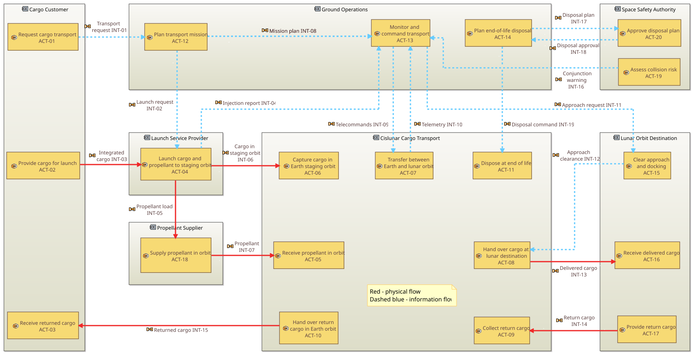

# Operational Analysis (Capella)

**Issue:** 1 (30 September 2026)

The operational analysis models what seven stakeholders need to do to move cargo between Earth orbit and the Moon, without the tug in it: five capabilities, 20 activities, 19 interactions and one round-trip scenario, drawn as four Capella diagrams. IDs continue the numbering of the mission definition note.

## 1. Modelling approach

In Arcadia, operational analysis describes what stakeholders need to achieve, not the solution. So the tug does not appear here. Its place is taken by the entity **Cislunar Cargo Transport**: the need to move cargo and propellant between Earth and lunar orbit, however it is met. In the system analysis that entity's activities become the functions of the System (the tug), and the other entities become external actors.

The plan's "be refuelled" capability is reworded the same way: stakeholders need **propellant replenished in orbit**; the tug being refuelled is one answer to that need.

| # | Capella diagram | What it shows | Status |
| --- | --- | --- | --- |
| OA-1 | Operational Capabilities Blank (OCB) | Capabilities, the entities involved, include/extend links | Core |
| OA-2 | Operational Architecture Blank (OAB) | Entities, their activities, and the interactions between activities | Core |
| OA-3 | Operational Entity Scenario (OES) | One full round trip as a message sequence | Core |
| OA-4 | Operational Activity Interaction Blank (OAIB) | The activity and interaction graph without the entity boxes | Added |

Build order matters: entities, then capabilities, then activities and interactions in the OAB, and the scenario last. The scenario's messages then reuse interactions that already exist instead of creating duplicates.

## 2. Operational entities

All seven are organisations or systems, so all are Operational Entities in Capella; none is a single human, so no Operational Actors are needed.

| ID | Name in Capella | Represents | Mission definition link |
| --- | --- | --- | --- |
| OE-1 | Cargo Customer | ESA programmes, international partners, commercial lunar payload providers | Stakeholders; MO-1, MO-2 |
| OE-2 | Launch Service Provider | Ariane 6 and its operator | C-1, A-09 |
| OE-3 | Cislunar Cargo Transport | The transport need the tug will meet (becomes the System in the system analysis) | D-01 |
| OE-4 | Ground Operations | Mission control and ground stations | Stakeholders |
| OE-5 | Lunar Orbit Destination | A lander or future logistics node in NRHO (NASA paused Gateway in March 2026) | A-05, D-03 |
| OE-6 | Propellant Supplier | Depot or tanker, left open for the refuelling trade-off | A-09 |
| OE-7 | Space Safety Authority | Collision-risk screening and disposal approval | C-3, MO-5 |

## 3. Operational capabilities

One umbrella capability includes delivery, refuelling and disposal; returning cargo extends delivery because it is optional on each trip.

| ID | Capability | Entities involved | Relation | Traces to |
| --- | --- | --- | --- | --- |
| OC-0 | Provide reusable cislunar cargo logistics | All seven | Includes OC-1, OC-3, OC-4; owns scenario SC-1 | MO-1 to MO-5 |
| OC-1 | Deliver cargo to lunar orbit | OE-1, OE-2, OE-3, OE-4, OE-5 | Included by OC-0 | MO-1, A-01 |
| OC-2 | Return cargo to Earth orbit | OE-1, OE-3, OE-4, OE-5 | Extends OC-1 | MO-2, A-02 |
| OC-3 | Replenish transport propellant in orbit | OE-2, OE-3, OE-4, OE-6 | Included by OC-0 | MO-3, A-09 |
| OC-4 | Dispose of transport assets safely | OE-3, OE-4, OE-7 | Included by OC-0 | MO-5, C-3, A-12 |

MO-4 (European launcher and technologies) is a constraint on how the need is met, not something stakeholders do, so it has no capability here; it becomes a non-functional requirement in the system analysis.

## 4. Operational activities

Twenty activities, named verb-first; seven belong to Cislunar Cargo Transport and will become the tug's top-level functions in the system analysis.

| ID | Activity | Allocated to | Capabilities |
| --- | --- | --- | --- |
| ACT-01 | Request cargo transport | OE-1 Cargo Customer | OC-1 |
| ACT-02 | Provide cargo for launch | OE-1 Cargo Customer | OC-1 |
| ACT-03 | Receive returned cargo | OE-1 Cargo Customer | OC-2 |
| ACT-04 | Launch cargo and propellant to staging orbit | OE-2 Launch Service Provider | OC-1, OC-3 |
| ACT-05 | Receive propellant in orbit | OE-3 Cislunar Cargo Transport | OC-3 |
| ACT-06 | Capture cargo in Earth staging orbit | OE-3 Cislunar Cargo Transport | OC-1 |
| ACT-07 | Transfer between Earth and lunar orbit | OE-3 Cislunar Cargo Transport | OC-1, OC-2 |
| ACT-08 | Hand over cargo at lunar destination | OE-3 Cislunar Cargo Transport | OC-1 |
| ACT-09 | Collect return cargo | OE-3 Cislunar Cargo Transport | OC-2 |
| ACT-10 | Hand over return cargo in Earth orbit | OE-3 Cislunar Cargo Transport | OC-2 |
| ACT-11 | Dispose at end of life | OE-3 Cislunar Cargo Transport | OC-4 |
| ACT-12 | Plan transport mission | OE-4 Ground Operations | OC-1 |
| ACT-13 | Monitor and command transport | OE-4 Ground Operations | OC-1, OC-2, OC-3 |
| ACT-14 | Plan end-of-life disposal | OE-4 Ground Operations | OC-4 |
| ACT-15 | Clear approach and docking | OE-5 Lunar Orbit Destination | OC-1 |
| ACT-16 | Receive delivered cargo | OE-5 Lunar Orbit Destination | OC-1 |
| ACT-17 | Provide return cargo | OE-5 Lunar Orbit Destination | OC-2 |
| ACT-18 | Supply propellant in orbit | OE-6 Propellant Supplier | OC-3 |
| ACT-19 | Assess collision risk | OE-7 Space Safety Authority | OC-4 |
| ACT-20 | Approve disposal plan | OE-7 Space Safety Authority | OC-4 |

## 5. Operational interactions

Nineteen interactions, named as nouns for what flows; seven are physical (cargo or propellant) and twelve carry information. Ground Operations commands the transport through one representative pair (INT-09, INT-10) to keep the diagram readable.

| ID | Interaction | From activity | To activity | Kind |
| --- | --- | --- | --- | --- |
| INT-01 | Transport request | ACT-01 Request cargo transport | ACT-12 Plan transport mission | Information |
| INT-02 | Launch request | ACT-12 Plan transport mission | ACT-04 Launch cargo and propellant | Information |
| INT-03 | Integrated cargo | ACT-02 Provide cargo for launch | ACT-04 Launch cargo and propellant | Physical |
| INT-04 | Injection report | ACT-04 Launch cargo and propellant | ACT-13 Monitor and command transport | Information |
| INT-05 | Propellant load | ACT-04 Launch cargo and propellant | ACT-18 Supply propellant in orbit | Physical |
| INT-06 | Cargo in staging orbit | ACT-04 Launch cargo and propellant | ACT-06 Capture cargo | Physical |
| INT-07 | Propellant | ACT-18 Supply propellant in orbit | ACT-05 Receive propellant | Physical |
| INT-08 | Mission plan | ACT-12 Plan transport mission | ACT-13 Monitor and command transport | Information |
| INT-09 | Telecommands | ACT-13 Monitor and command transport | ACT-07 Transfer between Earth and lunar orbit | Information |
| INT-10 | Telemetry | ACT-07 Transfer between Earth and lunar orbit | ACT-13 Monitor and command transport | Information |
| INT-11 | Approach request | ACT-13 Monitor and command transport | ACT-15 Clear approach and docking | Information |
| INT-12 | Approach clearance | ACT-15 Clear approach and docking | ACT-08 Hand over cargo | Information |
| INT-13 | Delivered cargo | ACT-08 Hand over cargo | ACT-16 Receive delivered cargo | Physical |
| INT-14 | Return cargo | ACT-17 Provide return cargo | ACT-09 Collect return cargo | Physical |
| INT-15 | Returned cargo | ACT-10 Hand over return cargo | ACT-03 Receive returned cargo | Physical |
| INT-16 | Conjunction warning | ACT-19 Assess collision risk | ACT-13 Monitor and command transport | Information |
| INT-17 | Disposal plan | ACT-14 Plan end-of-life disposal | ACT-20 Approve disposal plan | Information |
| INT-18 | Disposal approval | ACT-20 Approve disposal plan | ACT-14 Plan end-of-life disposal | Information |
| INT-19 | Disposal command | ACT-14 Plan end-of-life disposal | ACT-11 Dispose at end of life | Information |

The OA-level chain for delivery reads INT-01 → INT-02 → INT-03 → INT-06 → INT-09 → INT-12 → INT-13; in the system analysis it becomes the "cargo capture and transfer" functional chain.

## 6. Target layout for the OAB

*Red: physical interactions (cargo, propellant). Blue: information.*

Put Ground Operations across the top, launch-side entities on the left and the Moon side on the right; each physical flow then runs as one straight line, and the commands drop into the transport from above.

## 7. Round-trip scenario (SC-1)

> **Note after the trade-offs.** The loop guard and the two durations were first set at the mission definition reference point (18 kW): about 7 round trips, 14 months out and 8 months back. They now use the trade-off design point (25 kW, D-16), in this list and in the Capella scenario.

SC-1 is one full round trip in 15 messages, all reusing interactions from section 5; it lives under OC-0 because it spans delivery, return and refuelling. Lifelines, left to right: Cargo Customer, Launch Service Provider, Ground Operations, Cislunar Cargo Transport, Propellant Supplier, Lunar Orbit Destination.

| # | Message (interaction) | From | To | Phase |
| --- | --- | --- | --- | --- |
| 1 | Transport request (INT-01) | Cargo Customer | Ground Operations | Planning |
| 2 | Launch request (INT-02) | Ground Operations | Launch Service Provider | Planning |
| 3 | Integrated cargo (INT-03) | Cargo Customer | Launch Service Provider | Launch |
| 4 | Propellant load (INT-05) | Launch Service Provider | Propellant Supplier | Launch |
| 5 | Cargo in staging orbit (INT-06) | Launch Service Provider | Cislunar Cargo Transport | Launch |
| 6 | Injection report (INT-04) | Launch Service Provider | Ground Operations | Launch |
| 7 | Propellant (INT-07) | Propellant Supplier | Cislunar Cargo Transport | Refuelling |
| 8 | Telecommands (INT-09) | Ground Operations | Cislunar Cargo Transport | Capture and departure |
| 9 | Telemetry (INT-10) | Cislunar Cargo Transport | Ground Operations | Outbound transfer |
| 10 | Approach request (INT-11) | Ground Operations | Lunar Orbit Destination | Arrival |
| 11 | Approach clearance (INT-12) | Lunar Orbit Destination | Cislunar Cargo Transport | Arrival |
| 12 | Delivered cargo (INT-13) | Cislunar Cargo Transport | Lunar Orbit Destination | Hand-over |
| 13 | Return cargo (INT-14) | Lunar Orbit Destination | Cislunar Cargo Transport | Hand-over |
| 14 | Telemetry (INT-10) | Cislunar Cargo Transport | Ground Operations | Return transfer |
| 15 | Returned cargo (INT-15) | Cislunar Cargo Transport | Cargo Customer | Return hand-over |

Add three fragments so the diagram carries the timing and reuse:

- **Loop** around messages 1–15, guard "repeat over the 15-year life (MO-3; about 9 round trips at the 25 kW design point (D-16))".
- **Duration constraint** between messages 8 and 10: "outbound transfer about 10.5 months at the 25 kW design point (D-16)".
- **Duration constraint** between messages 13 and 14: "return transfer about 6 months (lighter tug)".

Optional second scenario SC-2 under OC-4, for disposal: INT-16, INT-17, INT-18, then INT-19, between Ground Operations, Space Safety Authority and Cislunar Cargo Transport.

## 8. Decisions and assumptions

| ID | Decision or assumption | Why |
| --- | --- | --- |
| D-06 | The tug is absent from the operational analysis; the entity Cislunar Cargo Transport stands for the need | Arcadia keeps operational analysis solution-neutral |
| D-07 | "Be refuelled" becomes "Replenish transport propellant in orbit"; the Propellant Supplier stays generic | Keeps the depot-vs-tanker-vs-tank-swap trade open |
| D-08 | Returning cargo extends delivery instead of being a separate mission | Return cargo is optional on each trip (A-02) |
| A-14 | Getting returned cargo from the Earth staging orbit to the ground is out of scope | Explore2040 (p. 14) points to Earth return vehicles for that leg |
| A-15 | Propellant comes up on the same Ariane 64 as the cargo and reaches the transport through the Propellant Supplier | Follows A-09 |
| A-16 | One Ground Operations entity covers mission planning and control | Keeps the model small; split it in the system analysis if needed |

## 9. Diagrams

| # | Diagram | File |
| --- | --- | --- |
| OA-1 | Operational Capabilities Blank | [`OA-1_OCB.svg`](../capella/diagrams/operational-analysis/OA-1_OCB.svg) |
| OA-2 | Operational Architecture Blank | [`OA-2_OAB.svg`](../capella/diagrams/operational-analysis/OA-2_OAB.svg) |
| OA-3 | Operational Entity Scenario SC-1 | [`OA-3_OES_SC-1.svg`](../capella/diagrams/operational-analysis/OA-3_OES_SC-1.svg) |
| OA-4 | Operational Activity Interaction Blank | [`OA-4_OAIB.png`](../capella/diagrams/operational-analysis/OA-4_OAIB.png) |

The Capella model itself is in [`capella/CislunarCargoTug/`](../capella/CislunarCargoTug/).
