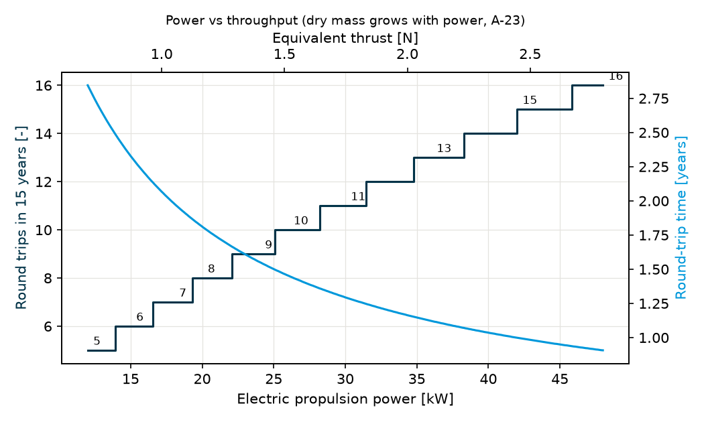

# Trade-offs: power vs transfer time, and refuelling concept

**Issue:** 1 (10 October 2026)

The trade-offs close the two open design questions from the system analysis: how much electric propulsion power the tug should have, and how it gets its xenon back. Trade 1 is quantitative and runs in the Python model (v0.2.0). Trade 2 is a weighted scoring whose scores, rationale and weight sets sit in a file next to the model, so the ranking can be rerun and challenged.

**Results in four lines**

- **Power: 25 kW to the thrusters (D-16).** Round trip 1.50 years, 9 trips in 15 years, 45 t of cargo delivered. That is 2 more trips than the 18 kW reference, and the 9 trips still hold with 10 % less power or with 60 % heavier power hardware.
- **Refuelling: fluid transfer from a propellant module launched with each cargo (R1, D-17).** It ranks first with the baseline weights and is never worse than second under five other weightings (with equal weights it ties for second with R2 and R3). It reuses European coupling work from the Gateway ESPRIT refuelling module.
- **The main finding is not about power at all.** Whatever the power, the tug thrusts for about 90,000 hours over its life, against 15,000–23,000 hours of rated thruster life. A faster tug just flies more trips. Thruster wear-out is now the top risk for the TRL and cost assessment (D-18).
- **Requirements updated:** 7 system requirements change value (SR-04, 05, 07, 08, 09, 10, 11), 2 are added (SR-25, SR-26), and 6 subsystem requirements follow (PROP-01, PROP-02, PROP-03, PWR-01, DRI-02, DRI-03).

## 1. Purpose and scope

The system analysis left the design point open on purpose. Three system requirements carried a "TBC by the trade-offs" (SR-04 round-trip time, SR-07 thrust, SR-11 power), and the Propellant Supplier actor and the refuelling chain FC-2 were kept generic "until the refuelling trade-off decides depot, tanker or tank swap". This step closes both.

| Trade | Question | Type | Decides | Feeds |
| --- | --- | --- | --- | --- |
| 1. Power vs transfer time | How much EP power gives the best throughput without breaking mass, launch or technology limits? | Quantitative: Python model, parameter sweep and sensitivities | SR-04, 05, 07, 08, 09, 10, 11; PROP-02, 03; PWR-01 | Logical architecture (power and propulsion); thruster TRL and cost |
| 2. Refuelling concept | How does the tug get about 2.5 t of xenon back every trip? | Qualitative: weighted scoring of 4 options, 7 criteria, 6 weight sets | Propellant Supplier actor, FC-2, SR-25, SR-26, DRI-02, DRI-03 | Logical architecture (docking and refuelling interface); cost per trip |

**Out of scope here:** the cost model (the TRL and cost assessment ranks cost drivers; here cost only enters Trade 2 as a qualitative criterion), the choice between a 12 kW-class and a 5 kW-class thruster (TRL assessment), and return cargo (D-13 still open; both trades keep the 500 kg return case).

**Method rule carried over from the earlier phases:** every input is a parameter with a unit, a reference (A-, C-, D-) and a source; every result is reproduced by `cislunar-tug run`; every judgement score has a written reason.

## 2. Trade 1 method: power level vs transfer time

**Design variable.** Electric power into the thrusters, P, from 12 to 48 kW. Everything else is held at its mission definition value: 5 t out and 0.5 t back (A-01, A-02), 2.64 km/s per leg (A-06), Isp 2,100 s and 60 % efficiency (A-17, A-19), 85 % duty cycle (A-17), 60 days of end operations per trip (A-18) and a 15-year life (A-03).

**Model chain.** Each step is a function in `trades.py` / `mission.py` and is unit-tested:

1. Thrust from power: T = 2ηP / (g₀ Isp). At 18 kW this gives the mission definition value of 1.05 N (CALC-03).
2. Dry mass grows with power: m\_dry = 5.9 t + α (P − 18 kW), with α = 25 kg/kW (new assumption A-23, swept from 15 to 40 kg/kW). α covers the extra arrays, power processing units, thrusters, radiators and structure for each added kW.
3. Propellant per trip from the rocket equation, worked backwards from the end of the return leg, exactly as CALC-07.
4. Leg time = propellant × exhaust velocity / thrust / duty cycle. Round trip = outbound + return + 60 days.
5. Trips in life N = floor(15 years / round trip). Only whole trips count.
6. Thruster set and wear, for two thruster classes: a 12 kW class (the CALC-26 unit, rated 23,000 h) and a 5 kW European class (A-24, the flown PPS 5000 class, rated 15,000 h). Units firing at once N = P / unit power, rounded, so each unit runs near its nominal point; N + 1 are installed. Wear is counted in firing hours: thrusting hours over life = trips × thrusting time per trip. All N units fire together, and the N + 1 units take turns (A-27), so each unit fires N/(N + 1) of the thrusting time. Life used = hours per unit / rated life. Rated lifetimes the mission consumes = N × thrusting hours / rated life, whatever the spare policy.

**Figures of merit and limits.**

| Figure of merit | Why it matters | Limit or target |
| --- | --- | --- |
| Trips in 15 years and cargo per year | The tug exists to deliver cargo (MO-1) many times (MO-3) | Higher is better |
| Round-trip time | Delivery cadence for the customer; SR-04 | ≤ 2.0 years (the system analysis value) |
| Launch fit | Tug launch (dry mass + one trip of xenon) and every resupply launch (cargo + xenon) must fit one Ariane 64 to GTO | ≤ 11.5 t (C-1, SR-06) |
| Power margin | Arrays degrade, efficiency may be lower than assumed | The trip count must survive 10 % less power |
| Thrusters installed and wear | Count drives cost and complexity; wear decides whether the tug lasts 15 years | PROP-01, PROP-03 |
| Power class | Above the power levels of today's European platforms, the arrays and power electronics become a development item, not a purchase (SR-24) | Qualitative, carried to the TRL and cost assessment |

**Known simplification.** The model keeps the delta-v per leg independent of thrust. In reality a low-thrust spiral needs slightly more delta-v at lower thrust-to-weight, so the low-power points are a little optimistic and the high-power points a little pessimistic. It does not change the ranking.

## 3. Trade 1 results

*Source: `model/results/baseline/power_trade.csv` (α = 25 kg/kW).*

Throughput rises almost in step with power, because the transfer legs shrink as 1/P and only the 60 days of end operations stay fixed. The returns diminish slowly: cargo per year per kW falls from 0.14 t at 12 kW to 0.11 t at 48 kW. The trip count moves in whole steps, so some power levels sit just past a step (26 kW gives 10 trips with only 4 % margin) and others well inside one (25 kW).

The other figures of merit, for the levels that matter:

| EP power (kW) | Thrust (N) | Dry mass (t) | Xenon per trip (t) | Tug launch mass (t) | Resupply launch (t) | Thrusters installed (N+1), 12 kW / 5 kW class |
| --- | --- | --- | --- | --- | --- | --- |
| 12 | 0.70 | 5.75 | 2.44 | 8.19 | 7.44 | 2 / 3 |
| 18 (mission definition) | 1.05 | 5.90 | 2.49 | 8.39 | 7.49 | 3 / 5 |
| 22 | 1.28 | 6.00 | 2.52 | 8.51 | 7.51 | 3 / 5 |
| 24 (12 kW-class option) | 1.40 | 6.05 | 2.53 | 8.58 | 7.53 | 3 / 6 |
| **25 (chosen)** | **1.46** | **6.08** | **2.54** | **8.61** | **7.54** | **3 / 6** |
| 30 | 1.75 | 6.20 | 2.57 | 8.77 | 7.57 | 4 / 7 |
| 36 | 2.10 | 6.35 | 2.62 | 8.97 | 7.62 | 4 / 8 |
| 48 | 2.80 | 6.65 | 2.71 | 9.35 | 7.71 | 5 / 11 |

Two limits that might have stopped the power rising never bind. Dry mass grows by only 0.75 t from 18 to 48 kW, so xenon per trip grows by under 9 %. Neither the tug launch nor the resupply launch comes near the 11.5 t Ariane 64 limit, even after adding the propellant module from Trade 2 (about 0.5 t, A-25). Physics alone would keep pushing the power up. What stops it is cost, the power class of available European hardware, and the next chart.

| EP power (kW) | Trips in 15 years | Thrusting over life (kh) | 12 kW class: units × load | Hours per unit (kh) | Life used | 5 kW class: units × load | Hours per unit (kh) | Life used |
| --- | --- | --- | --- | --- | --- | --- | --- | --- |
| 12 | 5 | 99.9 | 1+1 × 100 % | 49.9 | 217 % | 2+1 × 120 % | 66.6 | 444 % |
| 18 | 7 | 94.9 | 2+1 × 75 % | 63.3 | 275 % | 4+1 × 90 % | 75.9 | 506 % |
| 22 | 8 | 89.8 | 2+1 × 92 % | 59.9 | 260 % | 4+1 × 110 % | 71.8 | 479 % |
| **24** | **9** | **93.1** | **2+1 × 100 %** | **62.1** | **270 %** | **5+1 × 96 %** | **77.6** | **517 %** |
| **25** | **9** | **89.7** | **2+1 × 104 %** | **59.8** | **260 %** | **5+1 × 100 %** | **74.7** | **498 %** |
| 30 | 11 | 92.6 | 3+1 × 83 % | 69.5 | 302 % | 6+1 × 100 % | 79.4 | 529 % |
| 36 | 13 | 92.8 | 3+1 × 100 % | 69.6 | 303 % | 7+1 × 103 % | 81.2 | 541 % |
| 48 | 16 | 88.5 | 4+1 × 100 % | 70.8 | 308 % | 10+1 × 96 % | 80.5 | 536 % |

*Source: `power_trade.csv`, columns `thrusting_kh_life` and `thruster_*`; rotation of N+1 units (A-27); rated lives 23,000 h (CALC-26) and 15,000 h (A-24). Units firing = P / unit power rounded to the nearest whole unit, halves up. Load = power per unit as a share of its nominal power.*

This is the most important result of the trade-offs. The tug spends most of its life thrusting: about 415 days of thrusting per 1.5-year round trip at 25 kW. A more powerful tug finishes each trip sooner but then flies more trips, so the total thrusting time over 15 years barely moves. Each thruster fires for about 60,000 to 80,000 hours even with the spare taking its turn: 2.6 to 5 times its rated life, depending on the class. Rotation spreads the load but cannot remove it: the mission consumes about 8 rated lifetimes of 12 kW-class units or 30 of 5 kW-class units, however they are shared. Power cannot fix this either. Section 4 and Trade 2 say how it is handled.

## 4. Trade 1 decision and sensitivity

**Decision D-16: baseline EP power 25 kW (thrust 1.46 N at 2,100 s).** About 27 kW of array power at end of life with the 2 kW platform load (A-21).

Why 25 kW and not a neighbour:

| Candidate | For | Against | Verdict |
| --- | --- | --- | --- |
| 18 kW (mission definition reference) | Lowest power and cost | 7 trips, and only 6 if power is 10 % short: the reference point was itself on the edge of a step | Rejected |
| 22 kW | 8 trips | Same thruster count as 24–25 kW for one trip less | Rejected |
| 24 kW | 9 trips; exactly two 12 kW-class thrusters at nominal power, plus one spare | Power margin for the 9th trip drops to 8 %; 5 kW-class units would run at 96 % | Kept as the 12 kW-class option (D-20) |
| **25 kW** | **9 trips with 12 % power margin; exactly five 5 kW European-class thrusters at nominal power, plus one spare (A-24, SR-24)** | **Thrusters still wear out (section 3)** | **Chosen** |
| 26 kW | 10 trips | Needs 25.03 kW for the 10th trip: a 4 % margin, gone with normal array degradation | Rejected: knife-edge |
| 30–48 kW | 11–16 trips | One Ariane 64 per trip means 11–16 resupply launches and a cargo demand nobody has stated yet; arrays and power electronics move into the 30–60 kW class, where the only comparable vehicle, Gateway's PPE, is a US development; no help with thruster wear | Kept as the growth path, not the baseline |

The last row is the real argument. Above about 25 kW the tug is limited by things the model does not price: demand for more than one delivery every 1.5 years, launch cadence, and European power hardware. The TRL and cost assessment puts numbers on those as cost drivers.

**Thruster configuration (D-20).** The power is matched to a whole number of thrusters at their nominal point, so no unit runs throttled down at lower efficiency. The two candidate classes give two configurations with the same 9 trips:

| Configuration | EP power | Thrusters | Thrust | Power margin for 9 trips | Hours per unit (rotation) | Life used | Lifetimes needed |
| --- | --- | --- | --- | --- | --- | --- | --- |
| **Baseline: 5 kW European class** | **25 kW** | **5 + 1** | **1.46 N** | **12 %** | **74.7 kh** | **498 %** | **29.9** |
| Option: 12 kW class | 24 kW | 2 + 1 | 1.40 N | 8 % | 62.1 kh | 270 % | 8.1 |

The 5 kW class is the baseline because it is flown European hardware (SR-24) and loses less thrust when one unit fails (one in five rather than one in two). The 12 kW class wears out more slowly, but needs a larger unit than Europe has flown. The TRL and cost assessment makes the final choice. In both cases the spare is not held idle: the units take turns (A-27), which spreads the firing hours over N+1 units. A cold spare would keep one fresh unit for a late failure; rotation is preferred because wear-out, not random failure, is the dominant risk.

**Sensitivity of the trip count** (one parameter changed at a time, all other values at baseline):

| Case | 18 kW | 25 kW | Reading |
| --- | --- | --- | --- |
| Baseline | 7 | 9 |  |
| 10 % less power (16.2 / 22.5 kW) | 6 | 9 | 25 kW keeps its trips; 18 kW does not |
| Specific mass 15 kg/kW (A-23 low) | 7 | 10 | Lighter hardware would give a 10th trip, just |
| Specific mass 40 kg/kW (A-23 high) | 7 | 9 | Dry mass is not a driver |
| End operations 120 days instead of 60 (A-18) | 6 | 9 (round trip 1.666 yr, at the limit) | The end-time assumption matters more than mass |
| Delta-v 3.1 km/s per leg before margin (A-06 high) | 5 | 7 | The biggest single sensitivity; tank sized for it (SR-08) |
| Isp 1,800 s (low end of the 5 kW European class) | 8 | 11 | More thrust per kW, but 20 % more xenon per trip (3.04 t) |

Two lessons for the requirements. First, the trip count is a step function, so a requirement on trips must come with a margin on the inputs, not just a nominal point; SR-05 below asks for 9 trips and SR-11 for 25 kW, which gives that margin. Second, the 60-day end time (A-18) is now the assumption to watch: it was a guess in the mission definition, and it eats a whole trip if it doubles. It is linked to the refuelling concept, which is Trade 2.

## 5. Trade 2: refuelling concept

Every trip the tug needs about 2.5 t of xenon back in the staging orbit (SR-09). One Ariane 64 per trip already brings up the cargo and that xenon together (A-09), so the question is not where the xenon comes from but how it gets into the tug.

**Options.**

| ID | Concept | How it works |
| --- | --- | --- |
| R1 | Fluid transfer from a co-launched propellant module | A passive xenon module rides up stacked with each cargo. The tug captures the stack once, transfers the xenon through a coupling in the docking port, then releases the empty module. |
| R2 | Tank-module swap | The tug's xenon tank is itself a separable module. The tug drops the empty one and latches a full one; only a feed-line quick-disconnect, no bulk transfer. |
| R3 | Depot in the staging orbit | A long-lived depot is filled by separate tanker launches; the tug docks with it every trip, as well as capturing the cargo. |
| R4 | Propulsion-module swap | As R2, but the swapped module also carries the thrusters, so every trip starts with new ones. Needs a 25 kW-class power connector mated in orbit. |

**Criteria and scores** (1 worst, 5 best). The rationale and source for every score are in `config/refuelling_trade.toml`; the most decisive ones are below the table.

| Criterion (weight %) | R1 | R2 | R3 | R4 |
| --- | --- | --- | --- | --- |
| C1 Maturity of the critical interface (20) | 4 | 3 | 2 | 2 |
| C2 Time added per round trip (10) | 4 | 5 | 3 | 5 |
| C3 Mass and complexity added to the tug (15) | 3 | 3 | 3 | 2 |
| C4 Recurring cost per trip (20) | 3 | 3 | 2 | 1 |
| C5 Restores thruster life (15) | 1 | 1 | 1 | 5 |
| C6 Debris and disposal (10) | 2 | 2 | 4 | 2 |
| C7 Fit with a future logistics network (10) | 3 | 3 | 5 | 4 |
| **Weighted total** | **2.90** | **2.80** | **2.60** | **2.75** |

- **C1 decides most of it.** Xenon transfer couplers were developed and ground-tested in Europe for the Gateway ESPRIT refuelling module, which transfers xenon to the PPE through docking-port couplers (TRL 5–6, not flown). Swapping a 3 t module has no such heritage: on-orbit replacement has only been shown for small units (Orbital Express, 2007). Nobody has built a xenon depot or mated a 25 kW connector in orbit. ESPRIT's future depends on Gateway, which NASA paused in March 2026, so the heritage is in the hardware and test data rather than in a flight.
- **C2:** the ESPRIT paper allows up to about three weeks for a xenon transfer, limited by thermal control during recompression. That fits inside the 60-day end time, but it uses a third of it, which links back to the A-18 sensitivity in section 4.
- **C5 is the Trade 1 finding.** Only R4 renews the thrusters, which is why it wins when thruster life gets the top weight.
- **C6:** R1, R2 and R4 all leave an empty module in a GTO-class orbit every trip. A low perigee makes it decay naturally; whether that meets Zero Debris timelines is TBD and becomes requirement SR-26.

| Weight set | R1 Fluid transfer | R2 Tank swap | R3 Depot | R4 Propulsion module swap | First |
| --- | --- | --- | --- | --- | --- |
| Baseline | **2.90** | 2.80 | 2.60 | 2.75 | R1 |
| Equal weights | 2.86 | 2.86 | 2.86 | **3.00** | R4 |
| Maturity first | **3.15** | 2.90 | 2.60 | 2.65 | R1 |
| Cost first | **2.95** | 2.90 | 2.60 | 2.45 | R1 |
| Thruster life first | 2.40 | 2.30 | 2.30 | **3.25** | R4 |
| Sustainability first | 2.75 | 2.65 | **3.15** | 2.70 | R3 |

*Source: `model/config/refuelling_trade.toml`, output `model/results/baseline/refuelling_trade_sensitivity.csv`.*

**Decision D-17: R1, fluid transfer from a co-launched propellant module.** It is first with the baseline, maturity-first and cost-first weights, and second in the other three. The scores are close (2.6 to 2.9), so the margin does not come from the arithmetic. It comes from robustness and from the most mature, European-built interface. Two options are kept on purpose:

- **R4 is the growth path for thruster life (D-18).** If the TRL and cost assessment confirms that thrusters cannot reach about 90,000 hours, the docking port of R1 is the natural place to add a later thruster-module exchange.
- **R3 is the path into a logistics network.** The R1 coupling is the same one a depot would use, so the tug does not close that door.

A side benefit of R1: the cargo and its xenon arrive as one stack, so one rendezvous per trip in Earth orbit does both jobs. Refuelling and cargo capture become the same operation, and the Propellant Supplier actor of the system analysis becomes a passive module launched with the cargo.

## 6. Impact on requirements, functions and the Capella model

**System requirements.** The system analysis numbering is kept; changed values are marked with the trade that changed them.

| ID | System analysis value | Trade-off value | Source |
| --- | --- | --- | --- |
| SR-04 | Round trip ≤ 2.0 years (TBC) | Round trip ≤ 1.66 years (model: 1.50) | D-16; 15 years / 9 trips |
| SR-05 | 15 years, ≥ 7 round trips | 15 years, ≥ 9 round trips | D-16 |
| SR-07 | ≥ 1.05 N at ≥ 2,100 s (TBC) | ≥ 1.46 N at ≥ 2,100 s | D-16, T = 2ηP / v\_e |
| SR-08 | ≥ 3,300 kg usable xenon | ≥ 3,400 kg usable xenon | 3.1 km/s case at 25 kW (3.39 t) |
| SR-09 | ≥ 2,500 kg replenished per trip | ≥ 2,550 kg per trip | 2.54 t per trip at 25 kW |
| SR-10 | ≥ 17.4 t of xenon over life | ≥ 22.8 t over life | 9 trips × 2.54 t |
| SR-11 | ≥ 18 kW to EP at end of life | ≥ 25 kW to EP at end of life, plus platform | D-16 |
| **SR-25 (new)** | – | The system shall capture the cargo and its propellant module as one stack in a single rendezvous per round trip. Allocated to SF-01, SF-02, SF-03.10. Verification T. | D-17, INT-06, INT-07 |
| **SR-26 (new)** | – | The system shall release the empty propellant module into an orbit that meets the applicable debris rules (decay time TBD). Allocated to SF-02. Verification A. | D-17, MO-5, C-3 |

**Subsystem requirements.**

| ID | Change | Why |
| --- | --- | --- |
| PROP-01 | 1.05 N → 1.46 N with one failed thruster; 5+1 units of the 5 kW class (2+1 of the 12 kW class at 24 kW as the option) | Follows SR-07, D-20 |
| PROP-02 | 3,300 kg and 7 refill cycles → 3,400 kg and 9 refill cycles | Follows SR-05, SR-08 |
| PROP-03 | Lifetime throughput 22.8 t, now expressed in firing hours: about 90,000 h of thrusting, about 75,000 h per unit with 5+1 rotation (5.0 rated lives of the 5 kW class; 29.9 lifetimes in total). With the 12 kW option: about 62,000 h per unit (2.7 rated lives; 8.1 in total). No qualified thruster meets it | Trade 1 finding, D-18, A-27; first item for the TRL and cost assessment |
| PWR-01 | 18 + 2 kW → 25 + 2 kW at end of life | Follows SR-11 |
| DRI-02 | Xenon coupling ≥ 2,550 kg per refuelling, transfer from a passive module within 21 days (TBC) | D-17, A-26 |
| DRI-03 | ≥ 56 → ≥ 54 mating cycles: capture and refuelling now share one mating, so 3 per trip × 9 trips × 2 margin | D-17 |

**Functions and the Capella model.** Trade 2 changes one actor and two descriptions; no function or exchange is added or removed.

- The **Propellant Supplier** actor becomes **Propellant Module**: a passive module launched stacked with the cargo. It still realises OE-6. Its function *Supply propellant in orbit* and the exchange FE-02 stay.
- **FE-01 Cargo in staging orbit** now carries the cargo and propellant module stack.
- **FC-2 Refuelling** keeps its path; its description records D-17.
- **SR-25 and SR-26** are added to the descriptions of SF-01, SF-02 and SF-03.10, and the changed values go into the descriptions written in the system analysis, so search for "SR-" still finds all 26.
- The design point (25 kW, 1.46 N, 2,100 s) is stored on the System as property values, so the model, not just this page, says what was chosen.

**New assumptions.**

| ID | Assumption | Value | Basis |
| --- | --- | --- | --- |
| A-23 | Added dry mass per extra kW of EP power | 25 kg/kW (swept 15–40) | Own estimate: arrays, power processing, thrusters, radiators, structure |
| A-24 | European thruster class for SR-24 | 5 kW, about 15,000 h rated life | Public catalogue listing of the PPS 5000 (satcatalog.com) |
| A-25 | Propellant module dry mass | About 0.5 t (20 % of the xenon load) | Own estimate: tank, structure, docking target |
| A-26 | Xenon transfer time | ≤ 21 days | ESPRIT refuelling allows up to about 3 weeks (NASA, IAC 2024) |
| A-27 | Spare thruster policy | Rotation: the N+1 units take turns, each fires N/(N+1) of the thrusting time | Own choice; wear-out, not random failure, is the dominant risk. Cold spare kept as the alternative (`spare_policy` in the model) |

**New decisions.**

| ID | Decision | Why | Left open |
| --- | --- | --- | --- |
| D-16 | Baseline EP power 25 kW | 9 trips with 12 % power margin; exactly five European 5 kW-class thrusters (D-20) | Growth to 30–48 kW if demand and launch cadence exist |
| D-17 | Refuelling by fluid transfer from a co-launched propellant module (R1) | Most mature, European-built interface; first or second under every weighting | Module disposal (SR-26) |
| D-18 | Thruster wear-out is the top risk for the TRL and cost assessment; propulsion-module swap (R4) kept as the growth path | About 90,000 h of thrusting vs 15,000–23,000 h rated, whatever the power | Spares, life extension or module exchange |
| D-19 | Propellant Supplier actor becomes Propellant Module; capture and refuelling share one rendezvous | Follows D-17 | – |
| D-20 | Thruster configuration: 25 kW with 5+1 units of the 5 kW European class (baseline); 24 kW with 2+1 units of the 12 kW class (option) | Each unit runs at nominal power; both give 9 trips; 5 kW class is flown European hardware (SR-24) | Final class chosen in the TRL and cost assessment |
